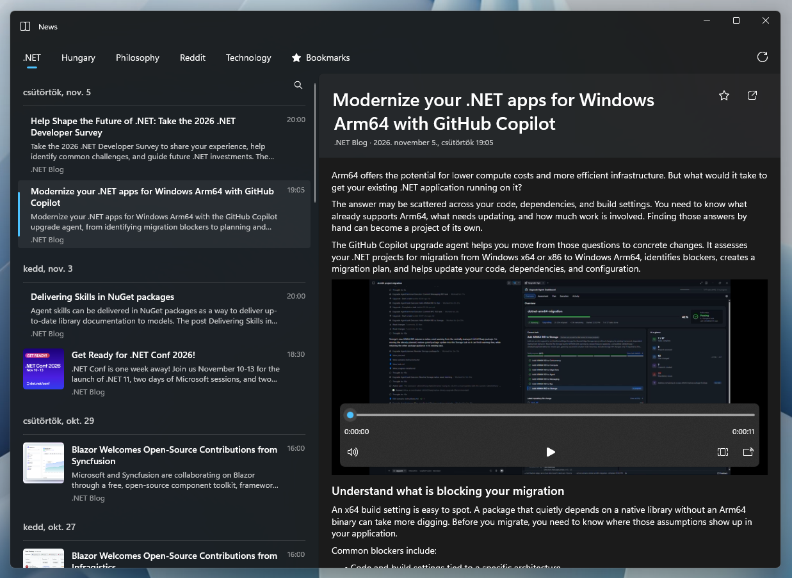

# News

A WinUI 3 news reader for Windows that gathers articles from many kinds of sources into tabbed groups, with a reading pane, search and bookmarks.



## Sources

Configured per group in [`groups.yml`](src/News.Client.WinUI3/groups.yml), each with its own refresh `frequency`:

- `rss` / `atom` — feeds, optionally with a CSS `selector` to fetch the full article from the linked page
- `html` — pages that list stories without a feed
- `reddit` — subreddits
- `youtube` — channels
- `github` — releases, tags, commits, issues or pull requests of a repository
- `x` / `x-search` — X accounts and searches

```yaml
groups:
  - title: .NET
    sources:
      - type: rss
        url: https://devblogs.microsoft.com/dotnet/feed/
        frequency: 00:30:00
        title: .NET Blog
```

## Configuration

[`appsettings.json`](src/News.Client.WinUI3/appsettings.json) sets the theme and the paths of the groups file, cache and bookmarks. Any setting can be overridden with environment variables or a `.env` file, e.g. `NEWS__GROUPSFILEPATH`.

## Build

Requires the .NET 10 SDK on Windows.

```powershell
dotnet run --project src/News.Client.WinUI3
```

Self-contained `win-x64` and `win-arm64` builds are published by the [Publish workflow](.github/workflows/publish.yml).

## Project layout

| Project | Purpose |
| --- | --- |
| `News.Client.WinUI3` | Desktop app |
| `News.Domain` | Core model |
| `News.Services` | Groups file, source clients, cache and bookmark storage |
| `News.Services.*` | Source implementations (Atom, RSS, HTML, GitHub, X) |
| `tests/News.Services.Tests` | Tests |
